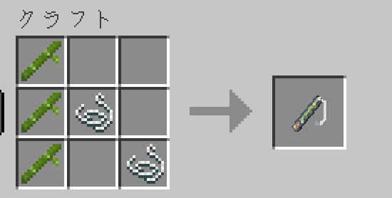
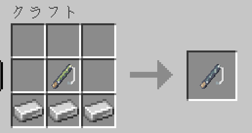
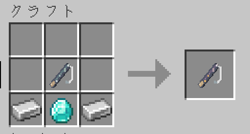
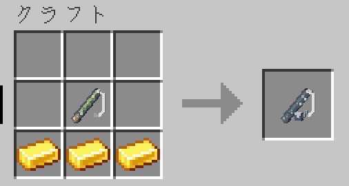
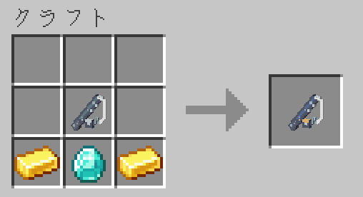
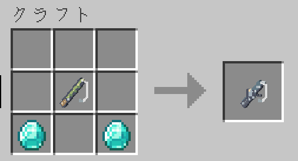
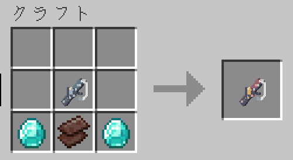

釣り場に合う竿を選ぶと、大きい魚を狙いやすくなり、当たりまでの待ち時間も短くなります。
川を楽しむなら渓流竿、海へ出るなら磯竿や船竿を用意してみましょう！

ここに載せている材料と個数は初期設定です。
いずれも作業台で作り、**材料を置く順番は自由**です。

## 釣竿のレシピ

| できる竿（各1本） | 材料 | 得意な場所 |
| --- | --- | --- |
| 竹竿 | 竹3個・糸2個 | 特になし |
| 渓流竿（並） | 竹竿1本・鉄インゴット3個 | 川 |
| 渓流竿（上） | 渓流竿（並）1本・ダイヤモンド1個・鉄インゴット2個 | 川 |
| 磯竿（並） | 竹竿1本・金インゴット3個 | 浅い海 |
| 磯竿（上） | 磯竿（並）1本・ダイヤモンド1個・金インゴット2個 | 浅い海 |
| 船竿（並） | 竹竿1本・ダイヤモンド2個 | 深い海 |
| 船竿（上） | 船竿（並）1本・ネザライトの欠片1個・ダイヤモンド2個 | 深い海 |

材料に指定された種類の竿を使ってください。
例えば渓流竿（上）には渓流竿（並）が必要で、通常の釣竿では代用できません。

「上」は「並」より、得意な場所で大きい魚が出やすく、待ち時間の短縮効果も大きくなります。
得意な場所でなくても、竿が対応する範囲では釣れます。

| 竿の系統 | 狙える魚の場所 |
| --- | --- |
| 竹竿・渓流竿・磯竿 | 川・浅い海 |
| 船竿 | 川・浅い海・深い海 |

:::note[エンチャントについて]
初期設定では、専用の釣竿にエンチャントを付けられません。
エンチャントテーブル・金床ともに対象です。通常の釣竿とは扱いが異なります。
:::

## 画像で見るレシピ

画像は材料の置き方の一例です。**材料の配置は自由**なので、同じ種類と個数をそろえて作業台に置いてください。
完成する竿は、どのレシピも1本です。

### 竹竿

### 渓流竿（並）

### 渓流竿（上）

### 磯竿（並）

### 磯竿（上）

### 船竿（並）

### 船竿（上）

## 餌のレシピ

餌は必須ではありません。釣りたい魚が決まったら使ってみましょう。

| 餌 | 材料 | できる数 | 出やすくなる魚 |
| --- | --- | --- | --- |
| ミミズ | 土1個・小麦の種1個 | 4個 | ウナギ・コハダ系 |
| エビ | 海草1個・骨粉1個 | 4個 | タイ・ヒラメ・サバ |
| イワシ | 通常の生鮭1個・コンブ1個 | 4個 | ハマチ系・カンパチ・サバ・サーモン |
| イカの切り身 | イカスミ1個・通常の生鱈1個 | 2個 | マグロ・カンパチ・イカ |

コハダ系にはコノシロ、ハマチ系にはブリも含みます。
サイズに応じて名前が変わる魚です。

## 餌を使う

1. 竿をメインハンドに持ちます
2. 専用の餌をオフハンドに持ちます
3. そのまま水面へ投げ、[合図に合わせて釣り上げます](../getting-started/#最初の1匹を釣ってみよう)

竿をオフハンドに持つ場合は、餌をメインハンドに持ちます。
専用の魚を釣り上げると餌を1個使います。駆け引きで逃げられた場合は戻り、通常の魚・宝物・ゴミでは減りません。

:::caution[餌は、染料や通常の材料とは別のアイテムです]
見た目が似ていても、普通の染料や骨粉を持つだけでは餌になりません。
アイテム名を確認してください。専用の餌は、作業台の材料や羊の染色には使えません。
:::

餌は出やすさを変えるもので、釣果を確定するものではありません。
竿が対応していない場所の魚を、餌だけで釣れるようにすることもできません。
