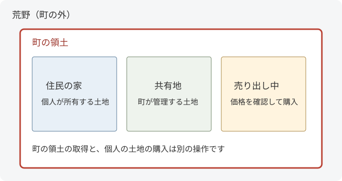

町の仲間と暮らしたり、自分たちの町をつくったりできるのがTownyです！
まずは「町を探す」「参加する」「家を建てる土地を相談する」の3つから始めてみましょう。
すべてのコマンドを覚える必要はありません。

## 最初にやってみること

### 1. 気になる町を探す

チャット欄で次のコマンドを入力します

```text
/town list
```

町の一覧が表示されます。
気になる町があったら、`/town 町名`で住民数や町長、税金などを見られます。
`町名`の部分は、一覧に出ている名前に置き換えてください。

名前が分からないときは、[全体チャット](../town/chat/)で「初めてです！ 参加できる町はありますか？」と聞いてみても大丈夫です

### 2. 町に参加する

自由参加の町なら、`/town join 町名`で参加できます。
招待制の町なら、町の人に招待してもらい、届いた案内を確認して承諾します。

招待の確認と入力方法は[町への参加と住民の操作](residents/)で案内しています。
参加前に、建築のルールと税金があるかも聞いておくと安心ですね！

### 3. 家を建てる場所を相談する

町に入っても、すべての場所に建築できるわけではありません。
町の人に空いている土地を案内してもらいましょう。

土地の上で`/plot perm`を実行すると、その区画の持ち主や設定を確認できます。
売り出し中の土地は`/plot claim`で購入できますが、**実行前に価格と土地の税金を確認**してください。

購入の手順は[家を建てる土地を買う](plots/)へ進んでください

## Townyの言葉を知る

| 言葉 | 意味 |
| --- | --- |
| 住民 / resident | Townyに登録されているプレイヤー。町に入っていない人も含みます |
| 町 / town | 住民が集まって土地を管理する集まり |
| 町長 / mayor | 町を管理する人。役職を持つ住民も一部の管理操作をできます |
| 区画 / plot・townblock | Townyが土地を分ける単位。標準では横16×縦16ブロックで、高さ方向も含みます。サーバー設定で大きさは変わります |
| 領土を取得 / town claim | まだ町ではない土地を、自分の町の領土にすること |
| 土地を購入 / plot claim | 町の中で売り出されている区画を、自分の所有地にすること |
| 荒野 / wilderness | どの町の領土にもなっていない場所。自由に使えるかはサーバールールによります |
| 国家 / nation | 複数の町が所属する集まり。プレイヤー個人ではなく、町が参加します |
| 前哨地 / outpost | 町の本体から離れた場所にある領土。利用できるかは設定によります |



図は仕組みを説明する例です。
町の領土にしただけでは、自分の個人所有地にはなりません。

## やりたいことから探す

| やりたいこと | 読むページ |
| --- | --- |
| 町に入りたい・招待を受け取りたい | [町への参加と住民の操作](residents/) |
| 家を建てたい・土地を売りたい | [土地の購入と売却](plots/) |
| 友達と一緒に建築したい | [建築と操作の権限](permissions/) |
| 境界を見たい・地図を開きたい | [地図・情報・便利な表示](information/) |
| 町をつくりたい・広げたい | [町の設立と領土](town-land/) |
| 町長として住民や設定を管理したい | [町の運営](town-management/) |
| 税金や町のお金を知りたい | [銀行・税金・維持費](economy/) |
| 国家に入りたい・つくりたい | [国家の参加と運営](nations/) |
| 同盟・敵対関係を設定したい | [国家の外交](diplomacy/) |
| 区画をまとめたい・地区をつくりたい | [土地の種類・グループ・地区](land-settings/) |
| 牢屋や保釈について知りたい | [牢屋と保釈](jails/) |
| 町や国家の仲間と話したい | [TownyChat](../town/chat/) |
| エラーが出て進めない | [困ったとき](troubleshooting/) |
| コマンド名から探したい | [コマンドの探し方と収録範囲](reference/) |

## このガイドの読み方

コマンド内の`町名`・`プレイヤー名`・`金額`などは、自分が使う値に置き換えます。
`[町名]`のような角括弧は「省略できる部分」で、括弧そのものは入力しません。
`on / off`はどちらか一方を入力します。
金額や町名の例は、実際のサーバー料金や存在する町を表すものではありません。

このWikiは**Towny 0.103.2.0の安定版**の実装を基準にしています（2026年10月15日確認）。
町長や国王もプレイヤーとして扱い、それぞれの操作を掲載しています。
機能の有効・無効、費用、待ち時間、役職の権限はサーバーごとの設定が優先です。
利用できない機能を使いたいときは、表示されたメッセージを添えて運営に相談してください。

基準にしたバージョンと公式資料は[収録範囲と出典](reference/#収録範囲と出典)で確認できます
